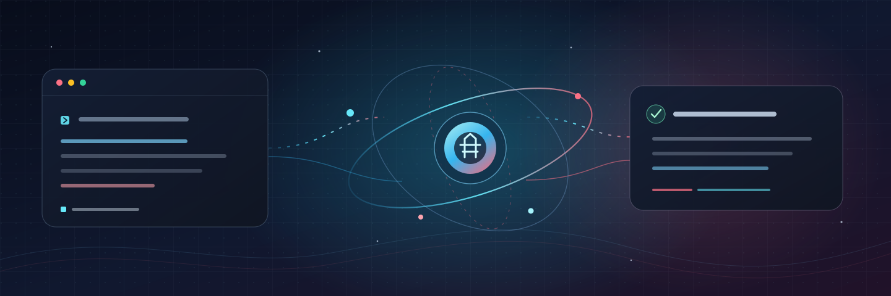

# Antigravity Subagent for DeepSeek Harness

<p align="center">
  <a href="https://www.npmjs.com/package/@xgone/dsh-subagent-antigravity"></a>
  <a href="https://www.npmjs.com/package/@xgone/dsh-subagent-antigravity"></a>
  <a href="https://github.com/xgone/dsh-subagent-antigravity/actions/workflows/ci.yml"></a>
  <a href="LICENSE"></a>
</p>

<p align="center"><strong>English</strong> · <a href="README.zh.md">中文</a></p>

<p align="center">
  
</p>

<p align="center"><strong>Delegate a task. Keep your main DSH conversation clean.</strong></p>

Give your DSH agent a second pair of hands: it hands a self-contained task to the **Google Antigravity CLI** (`agy`), which works inside your workspace in its **own DSH child Session** — so you can open that child and watch it think, type and run tools live — and then reports the answer back. You keep talking to DSH; Antigravity does the work.

Typical uses: a long review or research pass, a task that should not clutter your main conversation, or a job you want isolated in its own working directory.

Antigravity keeps its own login and settings. This plugin never stores credentials, never logs in, and never changes your Antigravity configuration.

## Agy account quota

When a DSH conversation is open, the composer footer shows a compact Agy account quota reading (remaining percentages only) at the right of the context-usage reading. Click or tap the pill for a compact panel with the next reset time and one progress bar per quota bucket (window names follow the interface language), plus the last refresh. The Host reads the local CLI output from `agy --print /usage --output-format json --print-timeout 30s` and refreshes once a minute. This uses Agy's CLI authentication and makes no direct Google API request. If the CLI is unavailable the pill reports that quota is unavailable. When the CLI is signed out the pill says you need to sign in from a terminal, and the background probe never opens a browser window — its process runs with browser openers neutralized, and a signed-out result is cached for ten minutes instead of being retried every minute.

## Install

**1. Install the Antigravity CLI** (once, if you have not already):

```bash
curl -fsSL https://antigravity.google/cli/install.sh | bash
agy --version
```

**2. Sign in once** in a normal terminal, so the headless child can reuse the cached credential:

```bash
agy
```

**3. Add the npm package to a DSH Profile:**

```bash
dsh plugin --profile <your-profile> add @xgone/dsh-subagent-antigravity
```

To install from a local checkout instead:

```bash
git clone https://github.com/xgone/dsh-subagent-antigravity.git
dsh plugin --profile <your-profile> add "$(pwd)/dsh-subagent-antigravity"
```

Restart DSH if the installer asks you to. The quota pill starts a brief local `agy --print /usage` check while the composer is open; a full Antigravity run starts only when you delegate a task.

## Configure

Open **Plugins → Installed plugins → Antigravity 子智能体** and click **Configure**. Two things are editable there:

- **Automatically delegate new tasks to Antigravity** — when on, DSH hides its built-in subagent tools and asks the model to send each new task to Antigravity, then relays the answer. The model may still answer directly or use other tools.
- **Antigravity permission mode** — how much the unattended session may do without asking you. The default `default` mode keeps command execution sandboxed and does not auto-approve actions. Choose `accept-edits` when workspace edits should be automatic; `dangerously-skip-permissions` runs everything without approvals or sandboxing and should only be used for workspaces you fully trust.

Everything else is set per Profile in `cordis.patch.yml`:

```yaml
- id: subagent-antigravity
  name: '@xgone/dsh-subagent-antigravity'
  config:
    command: /path/to/agy        # only needed if agy is not on PATH
    model: gemini-4-neon-high    # optional, see below
    effort: high                 # optional
```

| Setting | What it does | Default |
|---|---|---|
| `command` | Where the `agy` executable lives | `agy` from `PATH` |
| `model` | Antigravity model for every task from this Profile | Antigravity's own setting |
| `effort` | Reasoning effort, if the model supports levels | Antigravity's own setting |
| `permissionMode` | `default` / `accept-edits` / `auto` / `dangerously-skip-permissions` | `default` |
| `autoDelegate` | Send every new task to Antigravity automatically | `false` |
| `env` | Extra environment for the child process | `{}` |

### Use a different model

Run `agy models` to see the slugs your account can use, then put one in `model`:

```bash
agy models
```

```yaml
model: claude-sonnet-5-5-high
```

The model applies to every delegation from that Profile. DSH's generic "model selection" option is for DSH's own models, not for Antigravity slugs. If you need different tasks on different models, install the bundle twice under different provider names (each with its own row and tool name), or change the row and restart.

## Using it

- **Automatic:** with automatic delegation on, send a normal message — the local DSH subagent tools are hidden for that Agent, and the model is asked to call `subagent_antigravity` and relay its result. The model can still answer directly or use other tools.
- **Manual:** ask your agent to use `subagent_antigravity` for a specific task.
- **While it runs:** the Session header lists the live child under "N 个子智能体" (the Antigravity plugin no longer adds its own running badge — the child Session is the status). The child Session itself streams live — assistant text types out and every Antigravity tool step appears as a row with its command, state, duration, exit code, an openable file path and the real output (expand "已调用工具"/"tools called" in the child transcript), and the child's Trajectory tab has the full turn/step view — and you can keep talking to that child with `send_message` to continue the same Antigravity conversation.

## FAQ

**Nothing happens when I send a task.**
Check that the bundle is enabled in Plugins and that `agy --version` works in a terminal. If `agy` is not on DSH's `PATH`, set `command` to the absolute path.

**I get a "Product subagent failure … agy not found" message.**
DSH could not find the CLI. Install it, or point `command` at the binary.

**I get an authentication error.**
Run `agy` once in an interactive terminal to sign in. On machines without a terminal you can instead provide `GEMINI_API_KEY` (with `modelProvider: gemini`) or use Google Cloud ADC (`AGY_ADC_AUTH=true`).

**The task starts but commands are refused.**
That is the permission mode. Raise it to `auto`, or to `dangerously-skip-permissions` for trusted work only.

**My model name is rejected.**
Slugs must match `agy models` exactly. A wrong slug fails at run time with a safe error rather than being silently replaced.

**Where do I see the step-by-step work?**
In the child Session: open the "N 个子智能体" tree in the Session header and pick the running child. Its transcript streams assistant text and one card per Antigravity tool step with the real command output. The parent conversation still receives only the final answer or a clear failure message.

**Can I continue the same Antigravity conversation later?**
Yes. Send another message to the child (or ask the parent to), and the plugin reuses the same `agy` conversation — the CLI process is kept alive while the child Session is open and resumed with `--conversation` after a restart. Cancelling a turn ends the CLI process; the next message resumes the conversation.

**Does this store my API keys?**
No. It reuses Antigravity's own authentication. Any credential you deliberately pass to the child goes through the `env` setting in your own Profile file.

**Where is the running indicator?**
There is no separate Antigravity badge: the Session header's "N 个子智能体" entry is the status, and the child Session (with its live transcript and Trajectory tab) is where you see the work.

## More

- [Implementation notes](docs/implementation.md) — how it works, and why.
- [Antigravity CLI facts](docs/antigravity-cli-facts.md) — the exact CLI contract this is built against.
- [Verification record](docs/verification.md) — what has actually been tested.

## License

MIT — see [LICENSE](LICENSE).
