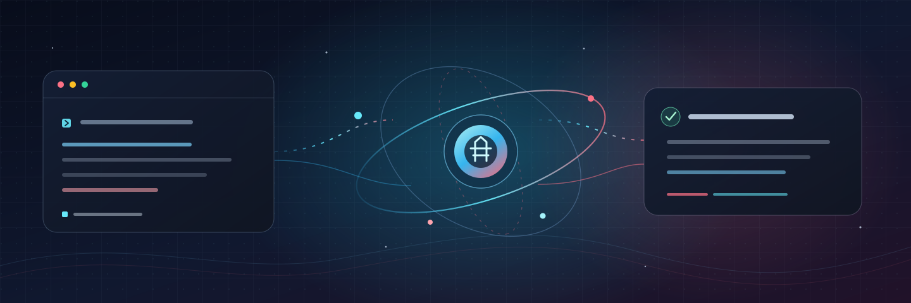

# Antigravity 子智能体（DeepSeek Harness）

<p align="center">
  <a href="https://www.npmjs.com/package/@xgone/dsh-subagent-antigravity"></a>
  <a href="https://www.npmjs.com/package/@xgone/dsh-subagent-antigravity"></a>
  <a href="https://github.com/xgone/dsh-subagent-antigravity/actions/workflows/ci.yml"></a>
  <a href="LICENSE"></a>
</p>

<p align="center"><a href="README.md">English</a> · <strong>中文</strong></p>

<p align="center">
  
</p>

<p align="center"><strong>把任务交给 Antigravity，让主 DSH 对话保持清爽。</strong></p>

给你的 DSH 智能体多一双手：它可以把一个自包含的任务交给 **Google Antigravity CLI**（`agy`），由后者在工作区里用一个全新的独立会话执行，并把最终答案回报给父会话。你始终和 DSH 对话，具体干活的是 Antigravity。

常见场景：一次较长的代码审查或资料调研、不希望弄乱主对话的任务，或者你希望隔离在独立工作目录里跑的工作。

Antigravity 的登录与设置完全由它自己管理。本插件不保存任何凭据、不代你登录，也不修改你的 Antigravity 配置。

## Agy 账号额度

打开 DSH 对话后，输入框下方会显示 Agy 账号额度和重置时间。Host 通过本机 CLI 读取 `agy --print /usage --output-format json --print-timeout 30s`，额度条每分钟刷新一次，并显示剩余额度比例。此功能复用 Agy CLI 的登录状态，不直接请求 Google API。CLI 未安装或未登录时会显示额度暂不可用。

## 安装

**1. 安装 Antigravity CLI**（已安装可跳过）：

```bash
curl -fsSL https://antigravity.google/cli/install.sh | bash
agy --version
```

**2. 先登录一次**，让无头子进程能复用缓存凭据：

```bash
agy
```

**3. 把 npm 包加到某个 DSH Profile：**

```bash
dsh plugin --profile <你的 Profile> add @xgone/dsh-subagent-antigravity
```

也可以从本地源码检出安装：

```bash
git clone https://github.com/xgone/dsh-subagent-antigravity.git
dsh plugin --profile <你的 Profile> add "$(pwd)/dsh-subagent-antigravity"
```

安装器提示需要重启时重启 DSH。对话输入框出现时，额度条会启动一次简短的本机 `agy --print /usage` 查询；只有真正委派任务时，才会启动完整的 Antigravity 子任务。

## 配置

打开 **Plugins → Installed plugins → Antigravity 子智能体**，点击**配置**，这里可以直接改两项：

- **自动将新任务交给 Antigravity** —— 开启后，DSH 会隐藏内置本地子智能体工具，并提示模型把每条新任务交给 Antigravity，再转交结果。主模型仍可直接回答或使用其他工具。
- **Antigravity 权限模式** —— 无人值守会话在不询问你的情况下能做多少事。默认 `default` 使用沙箱且不会自动批准；需要自动允许工作区文件编辑时可选 `accept-edits`。`dangerously-skip-permissions` 会跳过全部审批与沙箱，只在完全信任的任务和目录里使用。

其余配置写在 Profile 的 `cordis.patch.yml` 里：

```yaml
- id: subagent-antigravity
  name: '@xgone/dsh-subagent-antigravity'
  config:
    command: /path/to/agy        # 仅当 agy 不在 PATH 上时需要
    model: gemini-4-neon-high    # 可选，见下文
    effort: high                 # 可选
```

| 配置项 | 作用 | 默认 |
|---|---|---|
| `command` | `agy` 可执行文件位置 | 从 `PATH` 找 `agy` |
| `model` | 该 Profile 所有任务使用的 Antigravity 模型 | 沿用 Antigravity 自身设置 |
| `effort` | 推理强度（模型支持等级时） | 沿用 Antigravity 自身设置 |
| `permissionMode` | `default` / `accept-edits` / `auto` / `dangerously-skip-permissions` | `default` |
| `autoDelegate` | 自动把每条新任务交给 Antigravity | `false` |
| `env` | 给子进程的额外环境变量 | `{}` |

### 换用其它模型

先运行 `agy models` 查看你账号可用的模型标识，再把其中一个写进 `model`：

```bash
agy models
```

```yaml
model: claude-sonnet-5-5-high
```

模型对整个 Profile 的所有委派生效。DSH 通用的「模型选择」选的是 DSH 自己的模型，不是 Antigravity 的模型标识。如果不同任务要用不同模型，可以按不同 provider 名把本 bundle 挂载两次（各配一行工具和不同的工具名），或修改配置行后重启。

## 使用

- **自动模式**：开启后发普通消息即可；当前 Agent 看不到 DSH 内置的 `subagent` / `subagent_fork` 工具，主模型会被提示调用 `subagent_antigravity` 并转交结果。主模型仍可直接回答或使用其他工具。
- **手动模式**：要求智能体对某个任务使用 `subagent_antigravity`。
- **运行期间**：会话顶部会显示运行指示和任务数量；任务结束后指示消失，结果以普通回复出现在对话里。

## 常见问题

**发任务后没有反应？**
确认插件已在 Plugins 中启用，并且终端里 `agy --version` 可用。若 `agy` 不在 DSH 的 `PATH` 上，用 `command` 配置绝对路径。

**提示 “Product subagent failure … agy not found”？**
DSH 找不到 CLI。装好它，或把 `command` 指向可执行文件。

**提示认证失败？**
先在交互式终端里运行一次 `agy` 完成登录。没有终端的机器上，可改用 `GEMINI_API_KEY`（配合 `modelProvider: gemini`）或 Google Cloud ADC（`AGY_ADC_AUTH=true`）。

**任务开始了，但命令被拒绝？**
这是权限模式限制。可提高到 `auto`；仅在完全信任的工作里才用 `dangerously-skip-permissions`。

**模型名被拒绝？**
标识必须与 `agy models` 完全一致。写错会在运行时以安全错误失败，而不是被悄悄替换。

**为什么只拿到最终答案，没有过程？**
这是有意设计：子进程的推理、工具调用和终端输出都留在 Antigravity，不进入你的 DSH 对话。你只会拿到答案，或一条清晰的失败说明。

**之后能继续同一个 Antigravity 会话吗？**
不能。每次委派都是一次全新的一次性 `agy` 运行。

**会保存我的 API key 吗？**
不会。它复用 Antigravity 自己的认证。你主动传给子进程的凭据只通过你自己 Profile 文件里的 `env` 配置。

**顶部指示有时看不到？**
指示只在任务真正运行期间显示。任务很短时可能一闪而过，结果仍会出现在对话里。

## 更多

- [实现说明](docs/implementation.md) —— 工作原理与设计取舍。
- [Antigravity CLI 事实](docs/antigravity-cli-facts.md) —— 本插件依据的 CLI 契约。
- [验证记录](docs/verification.md) —— 实际验证过的内容。

## 许可

MIT，见 [LICENSE](LICENSE)。
